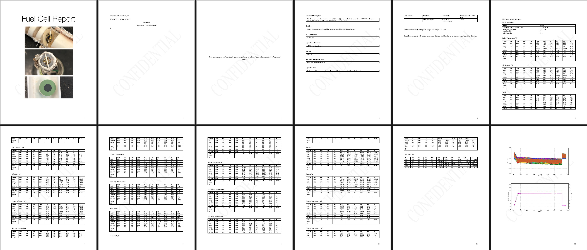

# Automated Report Generator

This jupyter notebook file makes short work of practical electrochemical cell data. Here hypothetical fuel cell data is provided as a template. This data is the input and a word document with test metadata, graphs, images, tables of statistics etc. is the output. The notebook will need to be updated to reflect your specific column(s) of interest.

## Document Output Preview:

