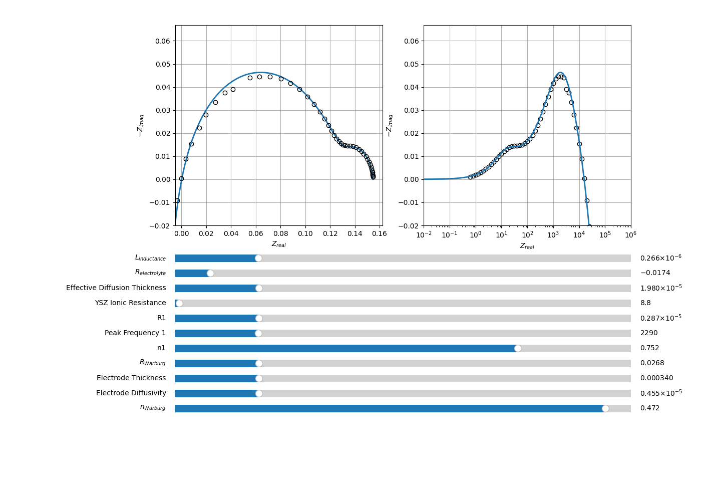

# EIS Interactive

This jupyter notebook file is specific to one equivalent circuit model and symmetric solid oxide cell data. Fitting to an equivalent circuit model is useful for understanding contributions within a, in this case, solid oxide cell. To fit to an equivalent circuit model, it is often useful to have initial values. It is also instructive to understand how different values for different parameters in the model affect the overal impedance prediction. Here, we use Nyquist and Bode plots to:

1) Show one set of parameters that fit well to real cell data
2) Show how adjusting each parameter affects the overall prediction. This is the interactive component

The equation for overall impedance for a specific equivalent circuit model must be predetermined and then this code can be modified to include it and the appropriate parameters.

## Workbook Preview:

